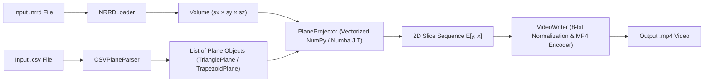
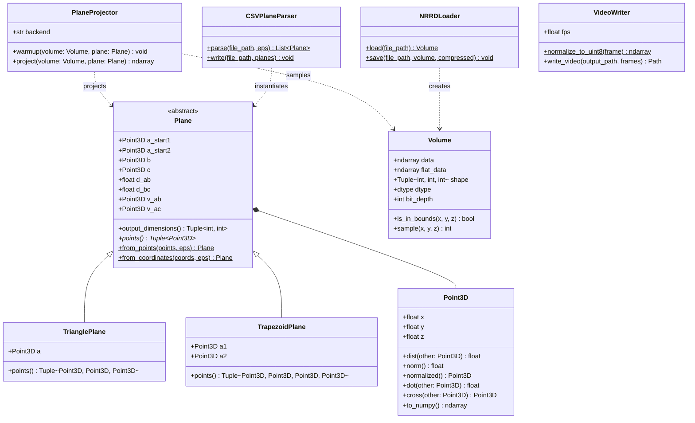

# Software Requirements Specification (SRS)
## Project: Ex1 — Implementing a Plane Projection of a 3D Volume

---

## 1. Introduction

### 1.1 Purpose
This Software Requirements Specification (SRS) defines the functional, non-functional, algorithmic, and architectural requirements for **Ex1: Implementing a Plane Projection of a 3D Volume**. The system loads a 3D volumetric raster dataset (`.nrrd`), projects a sequence of 2D geometric planes (isosceles triangles and isosceles trapezoids) defined in a `.csv` file onto 2D image matrices, and encodes the resulting frame sequence into an `.mp4` video container at high throughput.

### 1.2 Scope
Medical imaging and scientific visualization platforms (such as **3D Slicer**) frequently slice 3D volumetric scans (e.g., MRI or CT datasets) along arbitrary oblique planes. Because arbitrary 3D plane projection is underspecified in naive formulations, this project establishes:
1. A rigorous mathematical and geometric specification for **3-point (Isosceles Triangle)** and **4-point (Isosceles Trapezoid)** planar regions in $\mathbb{R}^3$.
2. A clean, extensible **Object-Oriented Design (OOD)** separating 3D geometry, volumetric memory management, vectorized/JIT projection kernels, and I/O adapters.
3. A high-performance execution engine capable of exceeding **100+ FPS** (with a strict minimum of **30 FPS**) on a $500 \times 500 \times 500$ voxel volume.

### 1.3 Definitions, Acronyms, and Abbreviations
| Term | Definition |
| :--- | :--- |
| **NRRD** | *Nearly Raw Raster Data* — standard volumetric file format used by 3D Slicer. |
| **Voxel** | A discrete volume element at integer coordinates $(x, y, z)$ in the 3D raster matrix $M$. |
| **EPS ($\epsilon$)** | Geometric floating-point tolerance constant set to `0.001`. |
| **FPS** | Frames Per Second — net number of 2D plane projections computed per second. |
| **JIT** | Just-In-Time compilation (via Numba `@njit(parallel=True, fastmath=True)`). |

---

## 2. Overall System Description

### 2.1 System Workflow


### 2.2 Domain Constraints
- **Volume Dimensions**: $M$ has dimensions $s_x \times s_y \times s_z$ where $1 \le s_x, s_y, s_z < 2^{10}$ ($1024$).
- **Voxel Data Types**: Unsigned integers of 8-bit (`uint8`), 16-bit (`uint16`), or 32-bit (`uint32`).
- **Coordinate Domain**: Valid voxel coordinates satisfy $0 \le x < s_x$, $0 \le y < s_y$, and $0 \le z < s_z$. Any sample point outside this domain evaluates to `0`.

---

## 3. Functional Requirements

### FR-1: Volumetric Data Ingestion (`NRRDLoader` & `Volume`)
- **FR-1.1**: The system shall read `.nrrd` files (supporting `raw`, `gzip`, and `ascii` encodings) into a `Volume` instance.
- **FR-1.2**: The `Volume` class shall enforce $1 \le s_x, s_y, s_z < 1024$ and store voxel values in contiguous C-order memory as `uint8`, `uint16`, or `uint32`.
- **FR-1.3**: Out-of-bounds queries (`x < 0`, `y < 0`, `z < 0`, `x >= sx`, `y >= sy`, or `z >= sz`) shall safely evaluate to `0` without raising an exception.

### FR-2: Geometric Entities & Plane Validation (`Point3D` & `Plane`)
- **FR-2.1 (`Point3D`)**: The system shall provide an immutable 3D vector/point primitive supporting Euclidean distance, vector addition/subtraction, scalar multiplication/division, dot product, cross product, and normalization.
- **FR-2.2 (`TrianglePlane` — 3 Points $a, b, c$)**:
  - Shall verify $|dist(a, b) - dist(a, c)| < \text{EPS}$ where $\text{EPS} = 0.001$.
  - Shall verify non-collinearity: $\|(b - a) \times (c - a)\| > \text{EPS}$.
  - Shall set $D_{ab} = dist(a, b)$, $D_{bc} = dist(b, c)$, $a_{start1} = a$, $a_{start2} = a$.
- **FR-2.3 (`TrapezoidPlane` — 4 Points $a_1, a_2, b, c$)**:
  - Shall verify coplanarity: perpendicular distance of $a_2$ from the plane spanned by $(a_1, b, c)$ is strictly less than $\text{EPS}$.
  - Shall verify equal legs: $|dist(a_1, b) - dist(a_2, c)| < \text{EPS}$.
  - Shall verify top width does not exceed base width: $dist(a_1, a_2) \le dist(b, c) + \text{EPS}$.
  - Shall set $D_{ab} = dist(a_1, b)$, $D_{bc} = dist(b, c)$, $a_{start1} = a_1$, $a_{start2} = a_2$.

### FR-3: CSV Plane Sequence Parsing (`CSVPlaneParser`)
- **FR-3.1**: Each non-empty, non-comment row in `<file.csv>` shall contain either 9 floating-point numbers (3 points) or 12 floating-point numbers (4 points).
- **FR-3.2**: Rows shall be parsed in sequential order, producing one `Plane` instance per row. Malformed rows or invalid geometries shall raise a descriptive `InvalidPlaneError` identifying the offending line number.

### FR-4: Exact 3D-to-2D Plane Projection (`PlaneProjector`)
- **FR-4.1**: Given a `Volume` $M$ and `Plane` $p$, the output 2D matrix $E$ shall have dimensions $\text{int}(D_{ab}) \times \text{int}(D_{bc})$ (height $\text{int}(D_{ab})$, width $\text{int}(D_{bc})$), initialized to `0`.
- **FR-4.2**: Normalized leg vectors shall be computed as:
  $$v_{ab} = \frac{b - a_{start1}}{D_{ab}}, \quad v_{ac} = \frac{c - a_{start2}}{D_{ab}}$$
- **FR-4.3**: For each integer step $y \in [0, \text{int}(D_{ab}))$:
  - $p_1(y) = a_{start1} + y \cdot v_{ab}$
  - $p_2(y) = a_{start2} + y \cdot v_{ac}$
  - $d_{12} = dist(p_1(y), p_2(y))$
  - $dp = \frac{p_2(y) - p_1(y)}{d_{12}}$ if $d_{12} > 0$, else $(0, 0, 0)$
  - For each integer step $x_1 \in [0, \text{int}(d_{12})]$:
    - $p = p_1(y) + x_1 \cdot dp$
    - $v = M[\lfloor p_x \rfloor, \lfloor p_y \rfloor, \lfloor p_z \rfloor]$ if $p \in [0, s_x) \times [0, s_y) \times [0, s_z)$, else $0$
    - $x = \text{int}\left(\frac{D_{bc}}{2} - \frac{d_{12}}{2} + x_1\right)$
    - Set $E[y, x] = v$.

### FR-5: Normalization & Video Encoding (`VideoWriter`)
- **FR-5.1**: 16-bit (`uint16`) and 32-bit (`uint32`) 2D projection matrices shall be normalized to 8-bit unsigned grayscale (`uint8`, range `[0, 255]`) prior to video encoding.
- **FR-5.2**: All projected frames shall be written sequentially into `<file.mp4>`. If planes in the same `.csv` have differing dimensions, frames shall be center-padded to uniform dimensions `(max_height, max_width)`.

### FR-6: Command-Line Interface (`Ex0.py` & `src/main.py`)
- **FR-6.1**: The program shall be executable from the repository root via:
  ```bash
  python Ex0.py <file.nrrd> <file.csv> <file.mp4>
  ```

---

## 4. Non-Functional Requirements

| ID | Category | Requirement |
| :--- | :--- | :--- |
| **NFR-1** | **Performance (Throughput)** | On a $500 \times 500 \times 500$ byte matrix, net projection throughput **must** exceed **30 FPS** ($\le 33.3\text{ ms/frame}$) and target **100+ FPS** ($\le 10.0\text{ ms/frame}$). |
| **NFR-2** | **Vectorization / Parallelism** | Pure Python nested pixel loops are prohibited in production projection paths; the engine must use vectorized NumPy 2D grid arithmetic and/or Numba `@njit(parallel=True, fastmath=True)`. |
| **NFR-3** | **Memory Safety** | All out-of-bounds 3D coordinates must be masked/clamped before array indexing to prevent segmentation faults or `IndexError`. |
| **NFR-4** | **Portability** | The system must run cleanly on Windows, macOS, and Linux, providing automatic fallbacks when optional native codecs or JIT compilers are absent. |

---

## 5. Object-Oriented Class Architecture



---

## 6. Testing & Verification Strategy

1. **Unit Tests — Geometry (`tests/test_geometry.py`)**:
   - Validates `Point3D` vector algebra (`dist`, `norm`, `dot`, `cross`).
   - Validates `TrianglePlane` acceptance when $|dist(a,b) - dist(a,c)| < 0.001$ and rejection when $\ge 0.001$ or collinear.
   - Validates `TrapezoidPlane` coplanarity check, equal leg check ($|dist(a_1,b) - dist(a_2,c)| < 0.001$), and base width ordering ($dist(a_1,a_2) \le dist(b,c)$).
2. **Unit Tests — Projection & Boundary Safety (`tests/test_projector.py`)**:
   - Compares vectorized/JIT projection output pixel-for-pixel against an explicit scalar reference implementation (`reference_scalar_project`) across synthetic 3D volumes for both `TrianglePlane` and `TrapezoidPlane`.
   - Verifies completely out-of-bounds planes return an all-zero matrix without errors.
   - Verifies partially out-of-bounds planes accurately project in-bounds voxels and clamp out-of-bounds voxels to `0`.
   - Verifies 8-bit (`uint8`), 16-bit (`uint16`), and 32-bit (`uint32`) volume handling and end-to-end NRRD + CSV + MP4 I/O round-trips.
3. **Throughput Benchmarking (`tests/benchmark.py`)**:
   - Allocates a $500 \times 500 \times 500$ `uint8` volume ($125,000,000$ voxels).
   - Performs warmup projections followed by 120 timed projections (alternating 3-point triangles and 4-point oblique trapezoids).
   - Asserts net throughput exceeds the 30 FPS minimum and verifies achievement of the 100+ FPS primary target.
